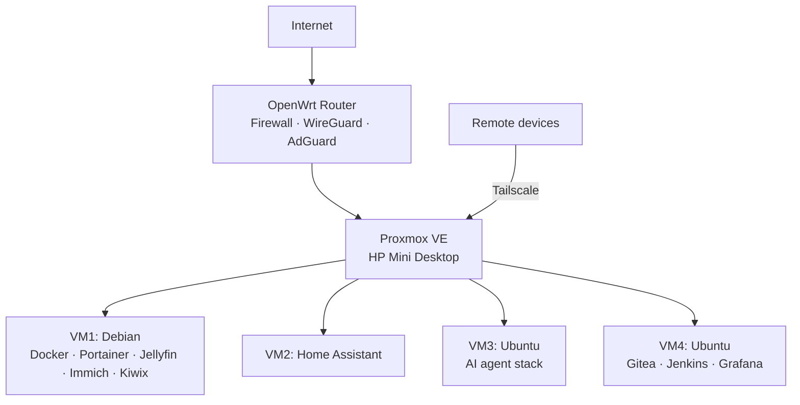

# Homelab: Self-Hosted Virtualized Infrastructure

A Proxmox-based homelab I use to practice Linux administration, containers,
CI/CD, monitoring, and secure networking. Everything is documented and
reproducible from this repo.

## Architecture

## Hardware and Virtualization
| Component | Details |
|---|---|
| Host | HP Mini Desktop, Ryzen 5 PRO 2400GE / 24 GB RAM |
| Hypervisor | Proxmox VE 9.2.11 |
| VMs | 4, see table below |

## Virtual Machines
| VM | OS | Purpose | Status |
|---|---|---|---|
| 1 | Debian | Docker services (Portainer, Jellyfin, Immich, Kiwix) | Running |
| 2 | Home Assistant OS | Home automation | Running |
| 3 | Ubuntu | AI agent environment | In progress |
| 4 | Ubuntu | CI/CD and monitoring | In progress |

## Networking and Security
- OpenWrt router with firewall rules, WireGuard VPN, AdGuard DNS filtering
- Remote access through Tailscale (no ports exposed to the internet)
- [Network segmentation, if any]

## AI Agent Environment
Evaluating AI coding agents in an isolated VM. Lessons learned on
risks and guardrails: [secrets handling, least privilege, review before running].

## What I Learned / Roadmap
- [x] Proxmox virtualization and VM management
- [ ] Automated backups with tested restores
- [ ] CI/CD VM
